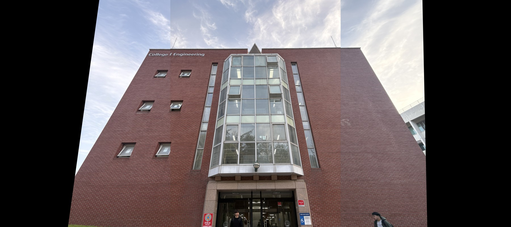
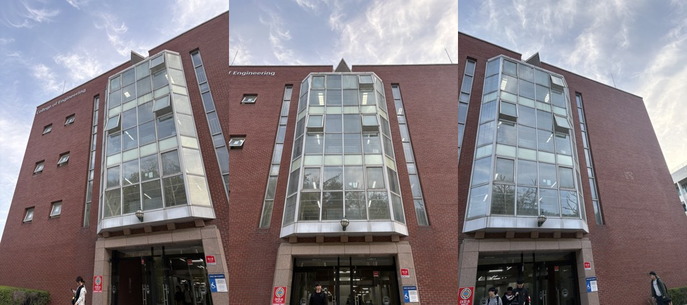
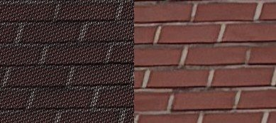

# Image Stitching · Forward & Backward Warping

**세 장의 사진을 하나의 평면으로 정합하고, 픽셀을 옮기는 방향과 보간 방식에 따른 결과 차이를 비교한 컴퓨터비전 수업 실습입니다.**

2026년 1학기 · 차량비전시스템 · 윤종범



## 구현한 내용

- 대응점으로 `Ah = 0`을 구성하고 NumPy SVD의 마지막 오른쪽 특이벡터로 **DLT Homography**를 계산했습니다.
- **Forward Warping**은 원본 픽셀을 `H`로 이동시켜 출력 캔버스에 대입하는 반복문으로 구현했습니다.
- **Backward Warping**은 출력 좌표에 `H⁻¹`을 적용하고, 원본의 이웃 네 픽셀을 **Bilinear Interpolation**으로 보간하는 함수로 구현했습니다.
- 좌·중앙·우 사진에서 모서리 대응점을 수동 선택하고, 중앙 사진을 기준으로 정합한 결과를 비교했습니다.

### 직접 구현과 OpenCV 사용 범위

| 파일 | 역할 |
| --- | --- |
| [`src/warping_math.py`](src/warping_math.py) | 직접 구현한 DLT·SVD, Bilinear Interpolation, 역방향 매핑 함수. 초기 `warping.py`에서 수학 함수만 분리했습니다. |
| [`src/stitching_forward.py`](src/stitching_forward.py) | 수동 대응점 선택 → `cv2.findHomography` → 직접 구현한 Forward Warping → 덮어쓰기 합성 |
| [`src/stitching_backward.py`](src/stitching_backward.py) | 수동 대응점 선택 → `cv2.findHomography` → `cv2.warpPerspective(..., INTER_LINEAR)` → 덮어쓰기 합성 |

위 파노라마는 당시 저장된 OpenCV 기반 Backward Warping 실행 결과입니다. 직접 작성한 수학 함수는 별도 학습 구현이며, 최종 스티칭 스크립트에서 호출하지 않습니다.

## 입력과 관찰



원본 픽셀을 정수 출력 좌표에 보내는 Forward 방식에서는 확대되는 영역에 빈 픽셀이 생겼습니다. 코드에서는 변환 좌표를 `int()`로 잘라 정수화합니다. Backward 방식은 출력 픽셀마다 원본 위치를 조회하고 보간하므로, 유효한 매핑 영역의 격자형 빈 공간을 줄일 수 있었습니다.



확대 이미지에서 왼쪽의 검은 격자 무늬가 Forward 매핑에서 생긴 빈 픽셀입니다. 결과에는 단순 덮어쓰기로 인한 경계, 시점 차이, 움직이는 사람의 불일치가 남아 있습니다. 자동 특징점 검출·RANSAC 기반 이상치 제거·노출 보정·다중 대역 블렌딩은 이 실습에 포함하지 않았습니다.

## 실행

Python 3와 OpenCV 창을 표시할 수 있는 데스크톱 환경이 필요합니다. WSL에서는 GUI 표시 환경이 필요합니다.

```bash
python -m pip install -r requirements.txt
python src/stitching_forward.py
python src/stitching_backward.py
```

각 프로그램에서 **Left → Center(for Left) → Right → Center(for Right)** 순서로 대응점을 선택합니다. 각 쌍에서 같은 물리적 모서리를 같은 순서로 최소 4개씩 찍습니다. 좌클릭은 추가, 우클릭은 마지막 점 취소, `q`는 현재 이미지 선택 완료입니다. 각 이미지 쌍의 점 개수는 같아야 합니다.

입력은 `data/left.jpg`, `center.jpg`, `right.jpg`, 출력은 `outputs/`입니다. 다른 사진을 사용할 때는 같은 파일명을 준비하고 `STITCHING_DATA_DIR` 환경 변수로 폴더를 지정할 수 있습니다. Forward 구현은 학습용 Python 이중 반복문이라 원본 해상도에서는 오래 걸립니다.

## 자료와 실행 범위

- WSL에 남아 있던 2026년 4월 실습 소스와 입력·결과 이미지를 정리했습니다.
- 공개 정리 과정에서 개인 경로를 상대 경로로 바꾸고, 실행 진입점·출력 폴더·이미지 로드 실패 처리를 추가했습니다. 의미 없는 주석 인용 표시는 제거했습니다.
- 입력 사진은 EXIF 회전 방향을 반영하고 위치 정보 등 메타데이터를 제거해 JPEG로 다시 저장했습니다. 미리보기는 당시 결과 이미지의 축소본입니다. 원본 보고서와 강의 자료는 포함하지 않았습니다.
- 공개 정리 시 Python 문법과 합성 좌표를 이용한 DLT·보간·워핑 함수의 수치 동작을 확인했습니다. 수동 대응점 좌표가 별도 저장되지 않아 당시 파노라마의 픽셀 단위 재현은 보장하지 않습니다. GUI 스티칭 전체를 새로 실행한 결과는 아닙니다.

이 저장소는 수업에서 다룬 기하 변환과 샘플링을 코드로 확인한 학습 기록입니다.
